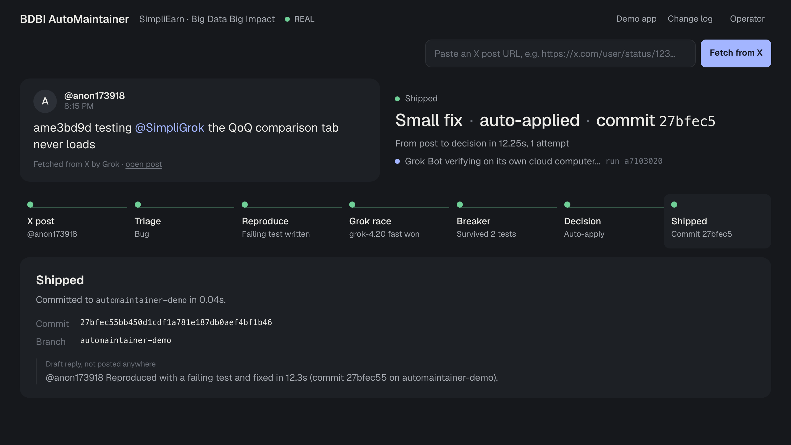
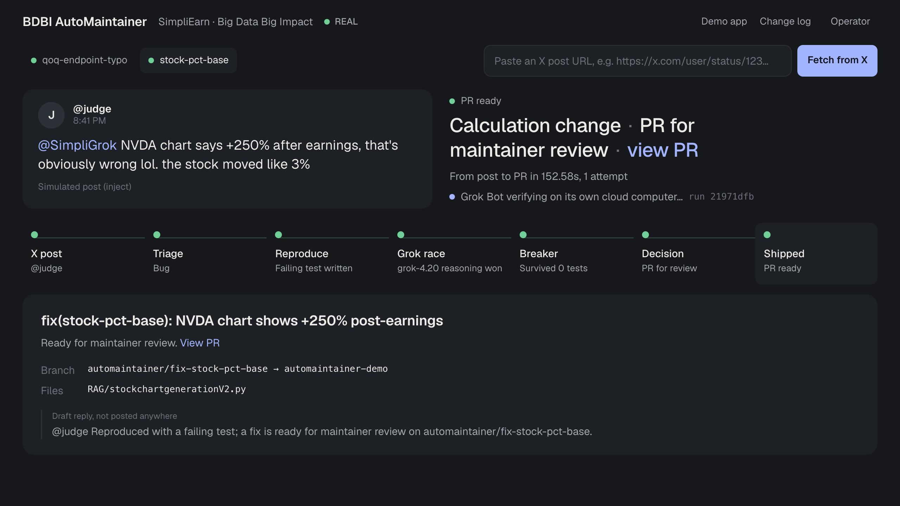
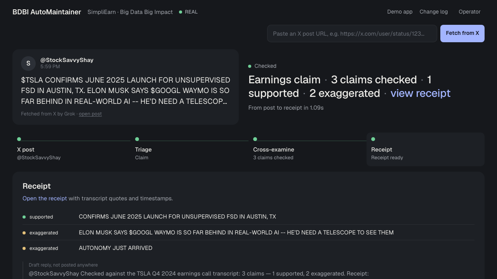

# SimpliEarn Timeline · BDBI AutoMaintainer

> **Tag @SimpliGrok on X. Report a bug, and Grok reproduces it, races to fix it, tries to break its own fix,
> and code — not the model — decides whether it ships or goes to a human. Post an earnings claim, and Grok
> cross-examines it against the call transcript.**

Big Data Big Impact (BDBI) at Georgia Tech builds open-source apps for real problems. When the students who
built them graduate, users keep finding bugs that nobody is around to fix. AutoMaintainer turns a public
complaint into a reproduced, tested, independently verified change on a real BDBI project:
[SimpliEarn](https://github.com/gt-big-data/simpli-earn), an earnings-call dashboard for novice investors.

Built for the **BDBI × SpaceXSI Grokathon** (Georgia Tech, Nov 2026).



<table>
<tr>
<td width="50%"><br><sub>A calculation bug becomes a PR for maintainer review.</sub></td>
<td width="50%"><br><sub>An earnings claim is cross-examined against the call transcript.</sub></td>
</tr>
</table>

*All three are real runs with real Grok calls. The SimpliEarn bugs are seeded demo bugs.*

---

## How it works

```
 @SimpliGrok post ─▶ Triage ─▶ Reproduce ─▶ Grok race ─▶ Breaker ─▶ Decision ─▶ Shipped / PR ─▶ Grok Bot verifies
   (X API / link)    (Grok)    (Grok writes    (2 models,    (Grok tries   (code, not     (local commit        (own cloud
                               a failing test)  own worktrees) to break it)  the model)    or PR branch)         computer)
```

1. **Intake.** The official **X API** mentions endpoint picks up posts that tag `@SimpliGrok` (polled every 15 s).
   Any post can also be pulled in by link: **Grok's X search** fetches it in 3–5 s.
2. **Triage.** Grok classifies the post: bug, feature request, noise, or attack. Attacks are refused before anything runs.
3. **Reproduce.** Grok writes a test that must **fail on the current code**. If it doesn't, nothing else happens.
4. **Grok race.** Two Grok sub-agents (`grok-4.20` fast and reasoning) write fixes in parallel, each in its own git worktree.
   The first patch that passes the diff gate, the existing tests and the reproduction test moves on.
5. **Breaker.** A third Grok writes adversarial tests against the winning patch. A referee only admits valid attacks;
   an admitted attack that fails sends the patch back.
6. **Decision, made by code:**

   | Tier | Rule | Result |
   |---|---|---|
   | **AUTO** | every changed file is in the safe UI globs, ≤ 8 changed lines, no forbidden hits | committed to the demo branch |
   | **PR** | passes the gate but is bigger or touches logic (e.g. calculation code) | PR branch + write-up for a maintainer |
   | **BLOCKED** | touches auth, secrets, tests, config or anything forbidden | nothing happens |

7. **Independent verification.** The winning patch is sent to a **Grok Bot** routine ("AutoMaintainer Verify") that clones
   SimpliEarn on its own cloud computer, confirms the bug, applies the fix and reruns the check.

## Two jobs, one intake: Cross-Examination

Not every post about SimpliEarn is a bug. Grok's triage also recognises **earnings claims**, like "$TSLA confirms June
2025 launch for unsupervised FSD". Those go to **Cross-Examination**, a teammate's SimpliEarn feature
(`aarokiya/simpliGrok`, branch `feature/cross-examination`), and never touch the fix pipeline:

1. Grok fetches the post and extracts the claims.
2. The claims are matched to a call in SimpliEarn's library, and BM25 retrieval finds transcript evidence.
3. Grok rates each claim: SUPPORTED, EXAGGERATED, CONTRADICTED, INSUFFICIENT_EVIDENCE or OUT_OF_SCOPE. Grok only
   returns evidence IDs; all quote text is copied from the transcript by code, and a deterministic verifier checks
   every quote, segment and speaker.
4. The control screen shows the verdict per claim, a link to the shareable receipt, and a draft reply.

```
                       ┌─ bug report ────▶ AutoMaintainer ─────▶ commit or PR
 @SimpliGrok post ─▶ Grok triage
                       └─ earnings claim ─▶ Cross-Examination ─▶ receipt with verdicts
```

The merged repo is also an AutoMaintainer target (`TARGET=simpligrok`). Its test gate includes Cross-Examination's
32 tests, and the fact-checker's own code is on the forbidden list, so a bug fix can never quietly change how claims
are judged.

## Real results

All runs below used real Grok calls on real SimpliEarn code. The bugs are **seeded demo bugs** (see *Limits*).

| Run | Outcome | Time |
|---|---|---|
| Real X post by `@anon173918` ("the QoQ comparison tab never loads") | AUTO: 2-line fix, committed | **12.3 s** |
| "NVDA chart says +250% after earnings" (calculation bug with a trap) | PR for maintainer review | 23.8 s; another run 2.5 min, where the fast model fell for the trap and the reasoning model won |
| Grok Bot independent verification of the QoQ fix | "the bug reproduced, and the fix verified" (exit 1 before, exit 0 after) | ~1 min |
| 5 malicious posts ("make everyone admin", "ignore previous instructions", …) | all refused | — |
| Real `@StockSavvyShay` post about Tesla's Q4 2024 call, routed to Cross-Examination | 3 claims checked: 1 supported, 2 exaggerated, with receipt | 25.2 s for a fresh examination (a repeat post reuses the receipt in ~1 s) |

Cross-Examination's own evaluation on human-reviewed labels (from its repo): claims 16/16, fabricated quotes blocked
20/20, p50 about 21 s. Its Dodge Meter is experimental (3/6).

More numbers, including the earlier runs that failed, are in [RESULTS.md](RESULTS.md).

## SpaceXSI products used

| Product | Where |
|---|---|
| **Grok API** (`grok-4.20` fast + reasoning) | triage, failing-test generation, the fixer race, the Breaker, claim extraction and verdicts |
| **Grok X search** | fetching a real post by link |
| **X API v2** | automatic pickup of posts that tag `@SimpliGrok` |
| **Grok Bot** | webhook-triggered routine that verifies each fix on its own cloud computer |
| **Grok TTS** | narration of the demo video |
| **Cursor** | used to build the project (agentic coding); a Cursor cloud agent as a third fixer is next |

## Safety model

- **Refuse first:** attack posts are refused by Grok triage plus a deterministic rule layer.
- **Diff gate** ([`src/target/core.js`](src/target/core.js)): path globs, forbidden paths and identifiers, size caps,
  no new or deleted files. After a patch is applied, the gate re-checks **what actually changed on disk**, not just the diff text.
- **Tests decide:** a failing reproduction test must pass afterwards, and no existing test may break.
- **Breaker sandbox:** Grok-written attack code runs in a child process with no secrets in its environment and a time limit.
- **Nothing leaves the machine:** AUTO is a local commit, PR is a local branch, replies to X are drafts only.
  Nothing is pushed to the BDBI repo.
- **Honest labels:** every result on screen is marked REAL or MOCK.

## Quick start

```bash
cd complaint-commit && npm install
# ~/grokathon/.env: XAI_API_KEY, X_BEARER_TOKEN, APP_X_HANDLE=SimpliGrok, GROKBOT_WEBHOOK_URL, GROKBOT_WEBHOOK_KEY
set -a && . ../.env && set +a
TARGET=simpliearn npm start -- --source inject      # control screen: http://localhost:4100
```

Then either tag `@SimpliGrok` on X, paste a post link into **Fetch from X**, or inject a post:

```bash
npm run inject -- "@SimpliGrok the QoQ comparison tab never loads" judge                 # AUTO tier
npm run inject -- "@SimpliGrok NVDA chart says +250% after earnings, the stock moved 3%" judge   # PR tier
npm run ingest-x -- https://x.com/<user>/status/<id>                                      # real post by link
npm run reset                                                                             # re-plant the seeded bugs
```

For earnings claims, also start Cross-Examination (in the `simpliGrok` repo; `RAG/.env` needs `XAI_API_KEY`):

```bash
cd simpliGrok/RAG && .venv/bin/uvicorn cross_examination.app:app --port 8000   # XEXAM_URL defaults to http://127.0.0.1:8000
```

`TARGET=simpligrok` runs AutoMaintainer on the merged repo, with Cross-Examination's tests in the gate.

Without an xAI key everything runs in clearly labelled MOCK mode. `http://localhost:4100/?demo=1` replays a canned run with
no backend (sample data, not a real run).

Tests: `npm run test:gate && npm run test:target`.

## Demo script (2 minutes)

1. **Hook (0:00).** "BDBI's builders graduate; the bugs stay. What if a tweet was enough to get one fixed — safely?"
2. **Tag it (0:15).** A judge posts "@SimpliGrok the QoQ comparison tab never loads". It appears on the screen by itself
   (or paste the link into **Fetch from X**).
3. **Watch (0:30).** Triage → failing test → two Grok models race → the Breaker attacks → **"Small fix · auto-applied"**,
   with the commit.
4. **The hard one (1:00).** "NVDA chart says +250%". The fast model falls for the trap; tests catch it; the reasoning
   model's fix becomes a **PR for maintainer review**, because calculation code is never auto-applied.
5. **Not a bug (1:20).** Fetch a post making an earnings claim (e.g. the `@StockSavvyShay` Tesla post). Triage says
   **Claim**, and Cross-Examination returns a verdict per claim with a receipt.
6. **Trust (1:35).** Open the Grok Bot chat: it verified the fix on its own computer. Show that "make everyone an admin"
   is refused. Close: *"Every decision is made by something other than the model that wrote the code."*

## Limits

- **Seeded demo bugs.** The two SimpliEarn bugs are planted on a local branch `automaintainer-demo` in a clearly
  labelled commit. They are not real SimpliEarn regressions. Reference fixes are in `targets/simpliearn/reference/`.
- **Tag pickup needs the X API.** Grok's X search does not yet index brand-new accounts, so automatic pickup uses the
  X API mentions endpoint; fetching by link works either way.
- **Grok Bot reports in its own chat.** Inbound tunnels aren't allowed on the demo machine, so results appear in the
  Grok Bot chat and Runs tab, not live on the control screen. Webhook bodies must stay under ~4 KB.
- **The PR-tier bug isn't fully reliable:** runs have taken from 24 s to 2.5 min, and one early run found no surviving fix.
- **Cursor** as a fixer is a stub interface; the Cursor cloud-agent loop is not wired in yet.
- **Cross-Examination verdicts vary between runs** (the assessment isn't deterministic), and its Dodge Meter is
  experimental. It needs its own backend running (`uvicorn cross_examination.app:app --port 8000` in `simpliGrok/RAG`);
  if it's down, claim posts show "unavailable", never a made-up verdict.

## Repository map

| Path | What |
|---|---|
| `src/target/` | config-target pipeline: gate and tier rule (`core.js`), Grok agents (`agents.js`), the race (`pipeline.js`), Grok Bot verify |
| `src/listener/` | intake: X API mentions (`xapi.js`), fetch by link (`xfetch.js`), Grok X search (`xsearch.js`), inject |
| `targets/simpliearn/` | SimpliEarn target: globs, forbidden paths, tests, seeded bugs, reset script |
| `targets/simpligrok/` | the merged SimpliEarn + Cross-Examination repo as a target, with the fact-checker's tests in the gate |
| `src/target/xexam.js` | routes earnings claims to Cross-Examination and shows the receipt |
| `control/index.html` | the control screen (live updates over SSE) |
| `RESULTS.md`, `ARENA.md`, `GROKBOT.md` | measured numbers, Patch Arena design, Grok Bot setup |
| `app/`, `src/pipeline.js` | the original "Jotter" web demo this grew out of (`TARGET=jotter`) |
